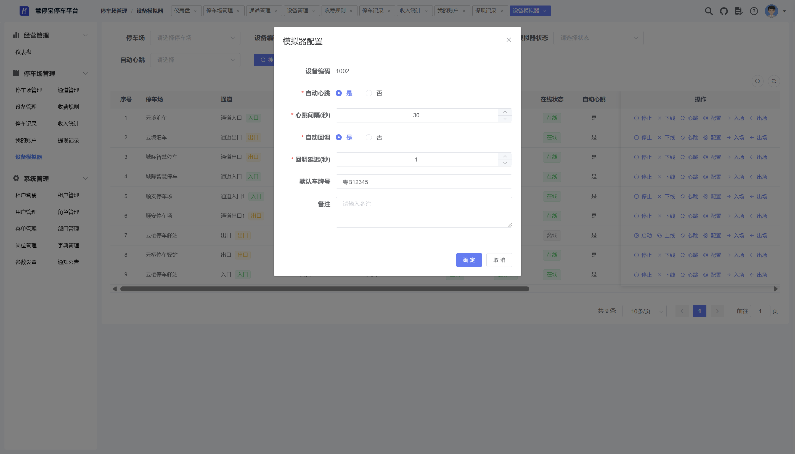
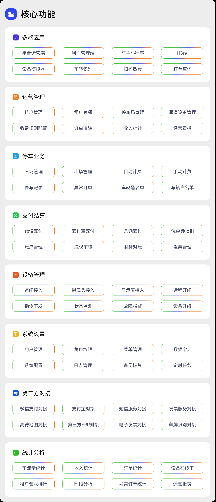

<div align="center">

# HUIMAO Parking 停车管理平台

</div>
<div align="center" >
    <a href="http://wenhui.huizhidata.com">
        
    </a>
    <a href="http://wenhui.huizhidata.com">
        
    </a>
     <a href="https://github.com/roinli/huige-ChargeOS-cloud/repository/archive/master.zip">
        
    </a>
</div>
<p align="center">
  
</p>
<p align="center">
</p>
<p align="center">
  <a href="http://huimao.huizhidata.com">官网</a> | <a href="http://huimao.pc.huizhidata.com">在线体验</a> | <a href="http://huimao.doc.huizhidata.com">帮助文档</a> | <a href="http://huimao.doc.huizhidata.com">技术社区</a>
</p>
<p align="center">
  如果对您有帮助，您可以点右上角 "Star" ❤ 支持一下谢谢！
</p>

---

## 📖 项目介绍
HUIMAO Parking 是一款基于 Apache-2.0 协议发布的开源停车场数字化解决方案。代码全开源无加密，可免费商用，适合各类物业、停车场运营方及开发者快速构建多租户一体化停车管理平台。





### 技术架构
系统采用 Java + Vue + uni-app 技术栈，基于 Spring Cloud Alibaba 微服务架构构建，前后端分离设计清晰。借助 uni-app 跨端能力，实现管理后台、车主小程序、H5 端全覆盖，数据统一、业务同步，极大提升开发与维护效率。同时系统代码规范清晰，注释详尽，二次开发十分方便。

### 核心功能
#### 全链路运营管理
平台核心管理功能完善，包含租户管理、停车场管理、通道设备管理、收费规则配置、订单追踪、财务统计、提现审核等，覆盖停车经营全流程。

#### 车主端便捷服务
提供扫码缴费、车牌查询、订单查看、支付结果反馈等轻量功能，实现"扫码即达、查询即用、支付即走"的高频闭环体验。

#### 设备智能接入
支持道闸、摄像头、显示屏等各类停车设备接入，实现入场/出场事件上报、心跳监测、远程开闸指令回调等设备联动能力。

#### 多租户SaaS能力
原生支持多租户隔离架构，可同时管理多个停车场运营主体，数据独立、权限隔离，满足平台化运营需求。

### 系统优势
#### 成熟稳定的微服务架构
后端：Spring Boot + Spring Cloud Alibaba，前端：Vue + ElementUI（管理端）与 uni-app（移动端），多端并行开发，结构清晰。

#### 规范的接口设计
提供标准 RESTful API 与统一数据结构，接口复用率高，逻辑层次清晰，便于二次开发与第三方系统集成。

#### 多维数据统计
集成 ECharts 实现经营数据看板，支持订单、收入、车流量等多维度统计分析，数据可导出，助力运营决策。

#### 高效开发支持
内置代码生成器，支持前后端代码一键生成，大幅减少重复工作，提升开发效率。

#### 精细权限控制
基于 Spring Security 实现 RBAC 角色权限控制，可精确到按钮级别，同时支持多租户数据隔离，保障系统安全。

#### 高可用设计
内置 Redis 缓存与 XXL-JOB 定时任务，有效削峰解耦，提升系统并发能力与稳定性。

---

## 💻 技术特点
### 运行环境及框架
1. 车主端 uni-app 开发框架 可生成微信小程序、H5
2. WEB PC 管理后台使用 Vue + Element UI 开发 兼容主流浏览器
3. 后台服务 Java Spring Boot + Spring Cloud Alibaba + MyBatis-Plus + MySQL + Redis
4. 运行环境 Linux 和 Windows 等都支持，只要有 Java 环境和对应的数据库、Redis
5. 运行条件 Java 1.8、MySQL 5.7+、Redis 5+

### Java 项目框架 和 WEB PC 项目运行环境
```
1. Spring Boot 2.7.x
2. Spring Cloud Alibaba 2021.0.5.0
3. Maven 3.6+
4. MyBatis Plus 3.5.x
5. Nacos 2.2.x
6. XXL-JOB 2.4.0
7. npm 6+
8. node 14+
9. vue 2.x
10. element ui 2.15.x
```

### 项目代码包介绍
```
1. huimao-platform  后端主工程  Spring Cloud Alibaba 微服务底座
2. huimao-ui        WEB程序     PC端管理端 VUE + ElementUI
3. huimao-miniapp   移动应用    UniApp标准开发(微信小程序 + H5)
4. huimao-doc       文档        项目设计文档、部署文档、使用文档
5. 接口文档         Api文档     部署项目后可在线查看 Swagger 接口文档
```

---

## 系统演示
管理后台：http://huimao.pc.huizhidata.com/
账号：hengtong      
密码：admin123456

车主端小程序：扫码体验  


H5：http://huimao-h5.huizhidata.com/

---

## 📚 项目资料
### 资料支持
使用文档：http://huimao.doc.huizhidata.com/
接口文档：http://huimao.doc.huizhidata.com//swagger-ui.html  
二开文档：http://huimao.doc.huizhidata.com/
技术社区：https://huimao.huizhidata.com/

### 安装教程
快速安装：点击查看  
安装步骤详解：http://huimao.doc.huizhidata.com/

---
## HUIMAO Parking 开源技术交流
欢迎加入 HUIMAO Parking 开源技术交流群，扫码进群免费领取接口文档、功能清单、思维导图、部署教程等资源！

<div align="center">


  <br>
  接口文档 | 产品功能清单 | 思维导图 | 安装教程
</div>

您还可以在 HUIMAO Parking 技术社区 中提交 Bug、交流解决方案、获取官方更新动态，HUIMAO Parking 技术社区伴您一路前行。

---



| 🔴 多端应用 | 🟠 运营管理 | 🟡 停车业务 | 🟢 支付结算 |
|------------|------------|------------|------------|
| 平台运营端 | 租户管理 | 入场管理 | 微信支付 |
| 租户管理端 | 租户套餐 | 出场管理 | 支付宝支付 |
| 车主小程序 | 停车场管理 | 自动计费 | 余额支付 |
| H5端 | 通道设备管理 | 手动计费 | 优惠券抵扣 |
| 设备模拟器 | 收费规则配置 | 停车记录 | 账户管理 |
| 车牌识别 | 订单追踪 | 异常订单 | 提现审核 |
| 扫码缴费 | 收入统计 | 车辆黑名单 | 财务对账 |
| 订单查询 | 经营看板 | 车辆白名单 | 发票管理 |

| 🔵 设备管理 | 🟣 系统设置 | 🟤 第三方对接 | ⚫ 统计分析 |
|------------|------------|--------------|------------|
| 道闸接入 | 用户管理 | 微信支付对接 | 车流量统计 |
| 摄像头接入 | 角色权限 | 支付宝对接 | 收入统计 |
| 显示屏接入 | 菜单管理 | 短信服务对接 | 订单统计 |
| 远程开闸 | 数据字典 | 发票服务对接 | 设备在线率 |
| 指令下发 | 系统配置 | 高德地图对接 | 租户营收排行 |
| 状态监测 | 日志管理 | 第三方ERP对接 | 时段分析 |
| 故障报警 | 备份恢复 | 电子发票对接 | 异常订单统计 |
| 设备升级 | 定时任务 | 车牌识别对接 | 运营报表 |

---

© 2026 HUIMAO Parking 版权所有  
开源协议：Apache-2.0  
技术支持：544061884@hqq.com