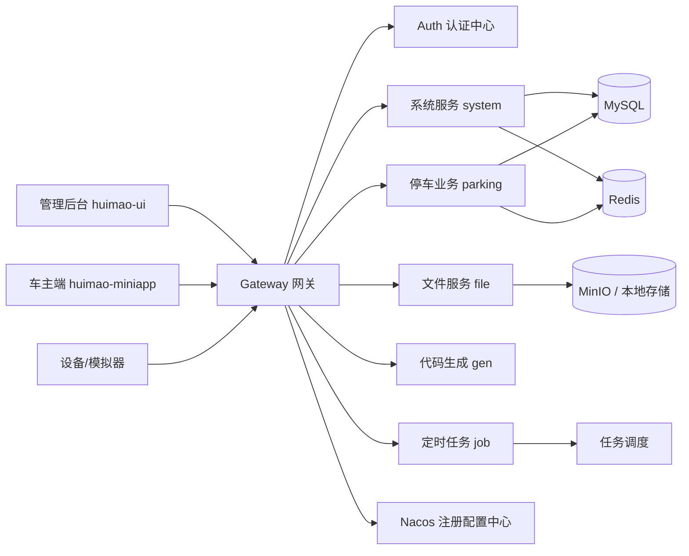

# HUIMAO Parking 全栈平台总览

> 一个面向停车场场景的多租户 SaaS 级管理平台，采用前后端分离、服务化拆分与统一治理的工程体系，覆盖运营管理、设备接入、收费结算、移动端支付与后台监管的完整闭环。

## 项目定位

HUIMAO Parking 并不是单一的业务系统，而是一套围绕“停车经营”构建的行业化平台能力集合。它以 `huimao-platform` 为核心后端底座，配合 `huimao-ui` 管理后台与 `huimao-miniapp` 车主端能力，形成一套可运营、可扩展、可演进的停车场数字化解决方案。

本仓库聚焦核心实现与交付代码，`huimao-doc/` 作为独立文档仓使用，不纳入本文档的架构范围。

## 总体架构

平台遵循“统一入口、领域拆分、能力复用、数据隔离”的设计原则，核心链路如下：



### 架构特征

1. 统一接入层由 `huimao-gateway` 承担，负责鉴权、路由、限流、跨域与基础安全控制。
2. 认证与授权体系独立演进，由 `huimao-auth` 统一承接登录、令牌与权限校验。
3. 业务域按能力拆分，停车核心能力沉淀在 `huimao-modules/huimao-parking`，避免与通用管理模块耦合。
4. 平台级基础能力集中在 `huimao-common`，实现通用工具、数据权限、缓存、日志、安全、消息等能力复用。
5. 前端管理台与移动端职责明确，分别面向运营人员和车主用户，避免同一端承载过多职责。

## 仓库结构

```text
F:\jianzhi\parking
├── huimao-platform        # 后端主工程与微服务底座
├── huimao-ui              # 管理后台前端
├── huimao-miniapp         # 车主端 / 小程序端
├── logs                  # 各服务运行日志
├── README.md             # 当前总览文档
└── huimao-doc             # 独立文档仓，不纳入本总览范围
```

## 核心工程拆解

### 1. `huimao-platform`

平台后端主工程，负责承载服务注册、配置治理、权限体系、业务服务和公共能力。

主要子模块包括：

```text
huimao-platform
├── huimao-gateway         # 网关层
├── huimao-auth            # 认证中心
├── huimao-register        # 注册与配置中心
├── huimao-api             # 对外接口契约
├── huimao-common          # 通用依赖沉淀
├── huimao-modules         # 业务模块集合
├── huimao-visual          # 监控与运维能力
├── huimao-demo            # 示例与演示模块
├── docker                # 容器化部署脚本
├── bin                   # Windows 启停脚本
└── sql                   # 初始化与业务建表脚本
```

### 2. `huimao-ui`

后台管理前端，承载平台运营端、租户端和业务管理页面，面向内部运营人员、租户管理员与平台管理员。

其设计目标是：

1. 统一承接后台运营操作。
2. 提供完整的权限菜单、租户管理与业务配置能力。
3. 与后端接口体系保持稳定契约，降低页面改造成本。

### 3. `huimao-miniapp`

车主侧轻量交互入口，强调扫码即达、查询即用、支付即走的高频闭环。

其设计目标是：

1. 车牌查询与停车缴费快速闭环。
2. 支持停车场二维码入口、订单查询、缴费结果反馈。
3. 与后台业务中心保持统一数据口径。

## 平台分层设计

### 接入层

负责承接管理后台、小程序端、设备模拟器与后续第三方系统接入，统一由网关进行流量调度与边界控制。

### 认证层

负责登录态、令牌、权限和租户上下文的统一治理，确保不同身份、不同租户、不同业务域的访问边界清晰可控。

### 业务层

以领域模型为核心，将停车业务拆分为停车场、通道、设备、订单、支付、账户、提现、统计等子域，形成清晰的职责边界。

### 基础能力层

由 `huimao-common`、`huimao-api`、`huimao-visual`、`huimao-register` 等模块提供支撑，包括：

1. 通用工具与规范化返回。
2. 数据权限与多租户隔离。
3. 缓存、日志、消息与安全能力。
4. 运维监控、任务调度与配置中心能力。

## 设计原则

### 1. 领域优先

停车业务属于强领域模型场景，因此优先按业务边界拆分模块，而不是按技术层机械堆叠。

### 2. 多租户隔离

所有核心业务围绕租户上下文展开，既满足 SaaS 运营模式，也确保平台侧与租户侧数据边界清晰。

### 3. 交易闭环

围绕“入场 - 计费 - 支付 - 放行 - 结算”的主链路设计表结构、接口和任务，确保业务流、数据流、设备流能够闭合。

### 4. 能力可复用

公共能力统一沉淀在 `huimao-common` 与基础服务中，避免业务模块之间重复建设。

### 5. 可演进架构

在首版稳定交付的前提下，为后续接入真实设备、扩展支付渠道、增强统计分析与运维能力预留演进空间。

## 业务能力地图

### 后台运营能力

1. 租户管理
2. 租户套餐
3. 停车场管理
4. 通道与设备管理
5. 收费规则配置
6. 停车记录与订单追踪
7. 收入统计与经营看板
8. 账户管理与提现审核

### 车主端能力

1. 扫码进入停车场专属页面
2. 查询待缴订单
3. 发起缴费
4. 查看支付结果

### 设备侧能力

1. 入场事件上报
2. 出场事件上报
3. 心跳与状态监测
4. 开闸指令回调与结果确认

## 关键技术栈

1. 后端：Spring Boot、Spring Cloud 体系、MyBatis-Plus
2. 注册配置：Nacos
3. 缓存：Redis
4. 调度：XXL-JOB
5. 数据库：MySQL
6. 前端后台：Vue 体系
7. 小程序端：uni-app
8. 部署：Docker、Docker Compose、脚本化交付

## 服务协作关系

### `huimao-gateway`

统一暴露外部访问入口，负责路由、白名单、认证透传和安全过滤。

### `huimao-auth`

负责登录认证、权限签发与会话控制，是平台安全边界的核心枢纽。

### `huimao-system`

承载系统级管理能力，包括用户、角色、菜单、部门、租户、字典等基础域。

### `huimao-file`

承载文件上传、存储与访问能力，为二维码、图片与业务附件提供统一支撑。

### `huimao-job`

承载定时任务与异步治理能力，用于统计、对账、补偿、校验等后台作业。

### `huimao-parking`

停车场行业核心业务服务，围绕停车场、设备、订单、支付、账户、提现和统计形成完整领域闭环。

## 目录之外的说明

`huimao-doc/` 中包含大量方案说明、模块设计与业务文档，适合详细阅读和交付沟通，但它不属于本文档的核心架构范围。

如果需要进一步了解某个业务域，建议优先查看：

1. `huimao-platform/README.md`
2. `huimao-platform/doc/停车场管理系统详细设计.md`
3. `huimao-platform/huimao-modules/huimao-parking` 下的代码结构

## 建议的阅读顺序

1. 先看本文件，建立整体认知。
2. 再看 `huimao-platform` 的模块划分与启动方式。
3. 然后进入 `huimao-parking` 业务模块理解停车主链路。
4. 最后补充阅读前端与小程序端实现。

## 一句话总结

HUIMAO Parking 的核心价值，不在于“有多少页面”，而在于它把停车场经营所需的权限、业务、设备、支付、结算和运营能力，组织成了一套可持续扩展的工程化平台。
